# Kế Hoạch Triển Khai v0 MVP: The Adversarial Crucible (Kiến Trúc Monorepo Chuẩn OpenCode)

> **Dành cho Agent / Kỹ sư thực thi:** BẮT BUỘC SỬ DỤNG SUB-SKILL: Dùng superpowers:subagent-driven-development (khuyên dùng) hoặc superpowers:executing-plans để triển khai kế hoạch này theo từng task. Các bước dùng cú pháp checkbox (`- [ ]`) để theo dõi tiến độ.

**Mục tiêu:** Xây dựng phiên bản v0 MVP của "The Adversarial Crucible" cho Sea x OpenAI Hackathon theo mô hình **Monorepo** với kiến trúc phân rã module trong `src/` chuẩn chỉnh như dự án **OpenCode** (`agent`, `bus`, `session`, `tool`, `provider`, `server`, `schema`). Tập trung vào 1 Hero Use Case: **Phòng Thử Tải Ý Tưởng Khởi Nghiệp (Startup Stress-Testing War Room)** với Cây Giả Định tương tác và Động cơ chạy mã mô phỏng OpenAI Codex.

**Kiến trúc Hệ thống:**
- **Monorepo (Turborepo + pnpm / Bun Workspaces):**
  - `packages/core`: Chứa domain schemas (Zod), interfaces chung, hợp đồng sự kiện (Event Bus definitions).
  - `packages/server`: Động cơ backend đa tác tử (Multi-Agent Engine) với cấu trúc module chuẩn OpenCode (`agent/`, `bus/`, `session/`, `tool/`, `provider/`, `server/`).
  - `packages/app`: Giao diện Web (Next.js 14+ / React, Tailwind CSS, `@xyflow/react` cho Cây Giả Định, Lucide icons, Framer Motion).
- **Tech Stack:**
  - Ngôn ngữ: TypeScript Full-stack (đảm bảo đồng bộ kiểu dữ liệu 100% từ core sang server và app).
  - Backend/Server: Node.js / Bun runtime, Hono (hoặc Fastify) hỗ trợ Server-Sent Events (SSE) siêu nhẹ, tốc độ cao.
  - Sandbox: Subprocess Python / Node Runner trong module `tool/codex-runner` để thực thi mã mô phỏng do OpenAI Codex sinh ra.
  - AI Client: OpenAI SDK (`gpt-4o`, `gpt-4o-mini`, `o3-mini`) với streaming và structured outputs.

**Tài liệu đặc tả (Spec):** [`/Users/nguyenbaoan/codeLab/codexhackathon/hackathon_strategy_and_winning_ideas.md`](file:///Users/nguyenbaoan/codeLab/codexhackathon/hackathon_strategy_and_winning_ideas.md)

---

## Cấu Trúc Monorepo & Phân Tách Module (Chuẩn OpenCode `src/`)

```
codexhackathon/
├── package.json                   # Root monorepo workspace configuration
├── turbo.json                     # Turborepo task pipeline (build, test, dev, lint)
├── tsconfig.json                  # Base TypeScript config
├── pnpm-workspace.yaml            # Monorepo workspace mapping (hoặc bunfig.toml)
├── packages/
│   ├── core/                      # @crucible/core (Nền tảng chia sẻ dùng chung)
│   │   ├── package.json
│   │   ├── tsconfig.json
│   │   └── src/
│   │       ├── schema/            # Zod schemas & Domain Types
│   │       │   ├── pitch.ts       # PitchSubmission, Assumption
│   │       │   ├── node.ts        # HypothesisNode, NodeStatus
│   │       │   ├── turn.ts        # SparringTurn, PersonaType
│   │       │   ├── simulation.ts  # SimulationResult
│   │       │   └── index.ts
│   │       ├── bus/               # Event bus contract & event types
│   │       │   ├── events.ts      # TurnStreamEvent, NodeUpdateEvent, ScoreEvent
│   │       │   └── index.ts
│   │       └── index.ts
│   │
│   ├── server/                    # @crucible/server (Kiến trúc chuẩn OpenCode src/)
│   │   ├── package.json
│   │   ├── tsconfig.json
│   │   └── src/
│   │       ├── config/            # Cấu hình môi trường (OpenAI API key, port, env)
│   │       │   └── index.ts
│   │       ├── provider/          # Tích hợp OpenAI SDK & Models
│   │       │   ├── openai.ts      # Client streaming, callStructured
│   │       │   └── index.ts
│   │       ├── tool/              # Tools & Runner (Thực thi code mô phỏng)
│   │       │   ├── codex-runner.ts# Python Sandbox Execution with timeout
│   │       │   ├── tool.ts        # Tool interface definitions
│   │       │   └── index.ts
│   │       ├── bus/               # Event Bus nội bộ (SSE & Event dispatching)
│   │       │   ├── event-bus.ts   # In-memory pub/sub for streaming events
│   │       │   └── index.ts
│   │       ├── session/           # Quản lý phiên làm việc & trạng thái bộ nhớ
│   │       │   ├── state.ts       # SessionState store & mutations
│   │       │   ├── score.ts       # Thuật toán tính Điểm Sinh Tồn (Survival Score)
│   │       │   └── index.ts
│   │       ├── agent/             # Hội đồng đa tác tử đối kháng (Personas & Loop)
│   │       │   ├── prompts/       # Prompts đối kháng
│   │       │   │   ├── cfo.txt
│   │       │   │   ├── competitor.txt
│   │       │   │   ├── customer.txt
│   │       │   │   └── supervisor.txt
│   │       │   ├── persona.ts     # Định nghĩa các Agent Persona
│   │       │   ├── supervisor.ts  # Trọng tài chống nịnh bợ (Anti-sycophancy)
│   │       │   ├── orchestrator.ts# Điều phối vòng lặp tranh luận (Sparring Loop)
│   │       │   └── index.ts
│   │       ├── server/            # HTTP Server & Endpoints
│   │       │   ├── routes/
│   │       │   │   ├── session.ts # POST /session/create
│   │       │   │   ├── spar.ts    # POST /session/:id/rebuttal, GET /session/:id/stream
│   │       │   │   └── preset.ts  # GET /presets (3 kịch bản demo mẫu)
│   │       │   ├── app.ts         # Khởi tạo Hono / HTTP App
│   │       │   └── index.ts
│   │       └── index.ts           # Entrypoint khởi chạy server
│   │
│   └── app/                       # @crucible/app (Frontend Web UI)
│       ├── package.json
│       ├── tsconfig.json
│       ├── tailwind.config.ts
│       └── src/
│           ├── app/
│           │   ├── layout.tsx
│           │   └── page.tsx       # Màn hình chính Split-screen War Room
│           ├── components/
│           │   ├── war-room/      # Khung tranh luận đối kháng
│           │   │   ├── ChatFeed.tsx
│           │   │   ├── PersonaBadge.tsx
│           │   │   └── RebuttalInput.tsx
│           │   ├── graph/         # Cây Giả Định tương tác
│           │   │   ├── HypothesisGraph.tsx
│           │   │   └── CustomNode.tsx
│           │   ├── terminal/      # Terminal hiển thị mã chạy OpenAI Codex
│           │   │   └── CodexTerminal.tsx
│           │   ├── metrics/       # Đồng hồ Điểm Sinh Tồn
│           │   │   └── SurvivalGauge.tsx
│           │   └── presets/       # Nút chọn kịch bản Demo nhanh
│           │       └── PresetSelector.tsx
│           ├── hooks/
│           │   ├── useSession.ts
│           │   └── useSparringStream.ts
│           └── lib/
│               └── utils.ts
└── docs/
    ├── pitch_and_demo_script.md
    └── superpowers/plans/
```

---

## Các Ràng Buộc Chung (Global Constraints)

- **Monorepo Linkage:** `packages/app` và `packages/server` trực tiếp import types và schemas từ `@crucible/core` thông qua workspace reference (`workspace:*`), không duplicate code type interface.
- **Thiết Kế Module Độc Lập Chuẩn OpenCode:** Mỗi folder trong `src/` (như `agent/`, `session/`, `tool/`, `bus/`) phải có một file `index.ts` làm public API của module đó. Các module bên ngoài chỉ được import qua `index.ts`, không import sâu vào nội bộ (deep import) để giữ ranh giới sạch sẽ.
- **Latency & Streaming:** Sử dụng Server-Sent Events (SSE) qua Event Bus của `packages/server`. Thời gian phản hồi token đầu tiên dưới 1.5 giây.
- **Codex Runtime Execution:** Module `tool/codex-runner.ts` chạy mã Python mô phỏng trong subprocess cách ly có timeout 3 giây. Kết quả mô phỏng (stdout/stderr + verdict) được bắn qua Event Bus để hiển thị trên `CodexTerminal.tsx` của frontend.

---

## 5 Tình Huống Kiểm Thử Trọng Yếu (Review Focus)

1. **Input rỗng / không hợp lệ:** Zod schema tại `packages/core/src/schema/pitch.ts` từ chối các input thiếu thông tin bắt buộc với thông báo lỗi rõ ràng.
2. **Vòng lặp nịnh bợ (Sycophancy Loop):** `packages/server/src/agent/supervisor.ts` bắt buộc từ chối lời giải trình không có bằng chứng số liệu, cấm các Persona tự ý thỏa hiệp.
3. **Mã Codex gặp lỗi cú pháp hoặc vô tận (Infinite Loop):** `packages/server/src/tool/codex-runner.ts` ngắt quá trình chạy sau 3 giây và gửi sự kiện lỗi mà không làm sập server hay ngắt stream SSE.
4. **Mất kết nối mạng giữa chừng:** `packages/server/src/session/state.ts` lưu trạng thái bền vững trong memory store; khi client reconnect vào `GET /session/:id/stream`, hệ thống truyền lại toàn bộ lịch sử.
5. **Giới hạn điểm sinh tồn (Survival Score):** Hàm `calculateSurvivalScore` trong `packages/server/src/session/score.ts` luôn trả về số nguyên trong khoảng `[0, 100]`.

---

## Phân Công Công Việc Nhóm 4 Thành Viên Theo Module

| Thành viên | Vùng phụ trách trong Monorepo | Nhiệm vụ chính |
| :--- | :--- | :--- |
| **UI/UX Designer** | `packages/app/src/components/`, `docs/` | Thiết kế giao diện War Room, Design Tokens, style Cây Giả Định, Slide pitch 10 trang, Kịch bản Demo 3 phút |
| **AI Engineer** | `packages/server/src/agent/`, `packages/server/src/tool/`, `packages/server/src/provider/` | Viết prompts đối kháng, tinh chỉnh Supervisor chống nịnh bợ, hoàn thiện Codex Python Runner |
| **Dev 1 (Backend)** | `packages/core/`, `packages/server/src/server/`, `packages/server/src/session/`, `packages/server/src/bus/` | Dựng Monorepo, Hono API routes, Event Bus SSE stream, Session State store, Unit tests |
| **Dev 2 (Frontend)** | `packages/app/` | Khởi tạo Next.js app, Cây Giả Định (`@xyflow/react`), Terminal chạy code, Hook kết nối SSE stream |

---

## Chi Tiết Các Nhiệm Vụ Kỹ Thuật (Tasks)

### Nhiệm Vụ 1: Khởi Tạo Monorepo & `@crucible/core` (Domain Schemas & Bus Events)
**Người phụ trách:** Dev 1 (Backend)  
**File cần tạo:**
- `package.json` (Root)
- `pnpm-workspace.yaml` / `turbo.json` / `tsconfig.json`
- `packages/core/package.json`
- `packages/core/src/schema/pitch.ts`
- `packages/core/src/schema/node.ts`
- `packages/core/src/schema/turn.ts`
- `packages/core/src/schema/simulation.ts`
- `packages/core/src/schema/index.ts`
- `packages/core/src/bus/events.ts`
- `packages/core/src/bus/index.ts`
- `packages/core/src/index.ts`
- `packages/core/test/schema.test.ts`

- [ ] **Bước 1: Viết test kiểm tra Zod Schema trong core**

```typescript
// packages/core/test/schema.test.ts
import { describe, it, expect } from "vitest";
import { PitchSubmissionSchema, HypothesisNodeSchema } from "../src/schema";

describe("Crucible Core Schemas", () => {
  it("validates a proper pitch submission", () => {
    const validPitch = {
      title: "Shopee Instant Fresh",
      targetCustomer: "Hộ gia đình thành thị",
      valueProp: "Giao rau củ quả trong 15 phút với AI gom đơn",
      pricingModel: "Phí ship 15.000đ + chênh lệch giá",
      primaryMoat: "Mạng lưới kho ngầm vi mô",
    };
    const parsed = PitchSubmissionSchema.safeParse(validPitch);
    expect(parsed.success).toBe(true);
  });

  it("rejects pitch with empty title", () => {
    const invalidPitch = { title: "", targetCustomer: "" };
    const parsed = PitchSubmissionSchema.safeParse(invalidPitch);
    expect(parsed.success).toBe(false);
  });
});
```

- [ ] **Bước 2: Cài đặt Zod Schemas chuẩn OpenCode**

```typescript
// packages/core/src/schema/node.ts
import { z } from "zod";

export const NodeStatusEnum = z.enum(["untested", "vulnerable", "critical", "defended"]);
export type NodeStatus = z.infer<typeof NodeStatusEnum>;

export const PersonaTypeEnum = z.enum([
  "Skeptical CFO",
  "Hostile Competitor",
  "Frugal Customer",
  "Audit Supervisor",
]);
export type PersonaType = z.infer<typeof PersonaTypeEnum>;

export const HypothesisNodeSchema = z.object({
  id: z.string(),
  label: z.string(),
  status: NodeStatusEnum.default("untested"),
  targetedBy: PersonaTypeEnum.optional(),
  flawSummary: z.string().optional(),
  defenseNotes: z.string().optional(),
});
export type HypothesisNode = z.infer<typeof HypothesisNodeSchema>;
```

```typescript
// packages/core/src/bus/events.ts
import { z } from "zod";
import { HypothesisNodeSchema } from "../schema/node";
import { SparringTurnSchema } from "../schema/turn";

export const TurnEventSchema = z.object({
  type: z.literal("turn:new"),
  sessionId: z.string(),
  turn: SparringTurnSchema,
});

export const NodeUpdateEventSchema = z.object({
  type: z.literal("node:update"),
  sessionId: z.string(),
  node: HypothesisNodeSchema,
  survivalScore: z.number(),
});

export type CrucibleEvent = 
  | z.infer<typeof TurnEventSchema>
  | z.infer<typeof NodeUpdateEventSchema>;
```

- [ ] **Bước 3: Chạy test và commit**  
Chạy: `pnpm --filter @crucible/core test`  
Kết quả: `PASS`  
Commit: `git add . && git commit -m "feat(core): setup monorepo and shared schemas"`

---

### Nhiệm Vụ 2: Module `tool/` & `provider/` – OpenAI Codex Simulation Runner
**Người phụ trách:** AI Engineer  
**File cần tạo:**
- `packages/server/src/provider/openai.ts`
- `packages/server/src/provider/index.ts`
- `packages/server/src/tool/codex-runner.ts`
- `packages/server/src/tool/index.ts`
- `packages/server/test/codex-runner.test.ts`

- [ ] **Bước 1: Viết test cho Subprocess Runner**

```typescript
// packages/server/test/codex-runner.test.ts
import { describe, it, expect } from "vitest";
import { executePythonSimulation } from "../src/tool/codex-runner";

describe("Codex Runner Tool", () => {
  it("executes valid python financial calculation", async () => {
    const code = `
cac = 45
ltv = 30
burn = 100000 / 12
print(f"LTV_CAC={ltv/cac:.2f}")
print(f"MONTHLY_BURN={burn:.0f}")
`;
    const res = await executePythonSimulation(code, 3000);
    expect(res.success).toBe(true);
    expect(res.output).toContain("LTV_CAC=0.67");
  });

  it("handles timeout on infinite loops safely", async () => {
    const evilCode = `while True: pass`;
    const res = await executePythonSimulation(evilCode, 1000);
    expect(res.success).toBe(false);
    expect(res.output).toContain("timed out");
  });
});
```

- [ ] **Bước 2: Cài đặt Module `codex-runner.ts` chuẩn OpenCode tool**

```typescript
// packages/server/src/tool/codex-runner.ts
import { spawn } from "child_process";

export interface ExecutionResult {
  success: boolean;
  output: string;
  durationMs: number;
}

export async function executePythonSimulation(code: string, timeoutMs = 3000): Promise<ExecutionResult> {
  const start = Date.now();
  return new Promise((resolve) => {
    const process = spawn("python3", ["-c", code]);
    let output = "";
    let isFinished = false;

    const timer = setTimeout(() => {
      if (!isFinished) {
        isFinished = true;
        process.kill("SIGKILL");
        resolve({
          success: false,
          output: `Execution timed out after ${timeoutMs}ms.`,
          durationMs: Date.now() - start,
        });
      }
    }, timeoutMs);

    process.stdout.on("data", (data) => { output += data.toString(); });
    process.stderr.on("data", (data) => { output += data.toString(); });

    process.on("close", (code) => {
      if (!isFinished) {
        isFinished = true;
        clearTimeout(timer);
        resolve({
          success: code === 0,
          output: output.trim(),
          durationMs: Date.now() - start,
        });
      }
    });

    process.on("error", (err) => {
      if (!isFinished) {
        isFinished = true;
        clearTimeout(timer);
        resolve({
          success: false,
          output: err.message,
          durationMs: Date.now() - start,
        });
      }
    });
  });
}
```

- [ ] **Bước 3: Chạy test và commit**  
Chạy: `pnpm --filter @crucible/server test:tool`  
Kết quả: `PASS`  
Commit: `git add packages/server/src/tool/ && git commit -m "feat(server): implement codex simulation runner"`

---

### Nhiệm Vụ 3: Module `agent/`, `session/` & `bus/` – Hệ Thống Đa Tác Tử Đối Kháng
**Người phụ trách:** AI Engineer & Dev 1  
**File cần tạo:**
- `packages/server/src/bus/event-bus.ts`
- `packages/server/src/bus/index.ts`
- `packages/server/src/session/state.ts`
- `packages/server/src/session/score.ts`
- `packages/server/src/session/index.ts`
- `packages/server/src/agent/prompts/` (cfo.txt, competitor.txt, customer.txt, supervisor.txt)
- `packages/server/src/agent/persona.ts`
- `packages/server/src/agent/supervisor.ts`
- `packages/server/src/agent/orchestrator.ts`
- `packages/server/src/agent/index.ts`
- `packages/server/test/orchestrator.test.ts`

- [ ] **Bước 1: Cài đặt Event Bus nội bộ chuẩn OpenCode (`src/bus/`)**

```typescript
// packages/server/src/bus/event-bus.ts
import { EventEmitter } from "events";
import { CrucibleEvent } from "@crucible/core";

export class EventBus {
  private emitter = new EventEmitter();

  publish(event: CrucibleEvent): void {
    this.emitter.emit(`session:${event.sessionId}`, event);
  }

  subscribe(sessionId: string, listener: (event: CrucibleEvent) => void): () => void {
    const eventName = `session:${sessionId}`;
    this.emitter.on(eventName, listener);
    return () => this.emitter.off(eventName, listener);
  }
}

export const globalBus = new EventBus();
```

- [ ] **Bước 2: Cài đặt Điều Phối Tác Tử (Orchestrator) & Trọng Tài Chống Nịnh Bợ (Supervisor)**
  - Tự động bóc tách 3 giả định cốt tử khi nhận Pitch.
  - Phân luồng câu hỏi cho CFO, Competitor hoặc Customer.
  - Supervisor kiểm tra bằng chứng trước khi đổi trạng thái node sang `defended`.

- [ ] **Bước 3: Chạy test và commit**  
Commit: `git add packages/server/src/agent/ packages/server/src/session/ packages/server/src/bus/ && git commit -m "feat(server): implement multi-agent sparring engine and event bus"`

---

### Nhiệm Vụ 4: Module `server/` – HTTP API & Server-Sent Events (SSE)
**Người phụ trách:** Dev 1 (Backend)  
**File cần tạo:**
- `packages/server/src/server/routes/session.ts`
- `packages/server/src/server/routes/spar.ts`
- `packages/server/src/server/routes/preset.ts`
- `packages/server/src/server/app.ts`
- `packages/server/src/server/index.ts`
- `packages/server/src/index.ts`

- [ ] **Bước 1: Dựng Hono App với SSE Streaming**

```typescript
// packages/server/src/server/app.ts
import { Hono } from "hono";
import { cors } from "hono/cors";
import { streamSSE } from "hono/streaming";
import { globalBus } from "../bus";
import { SessionManager } from "../session";

export function createServerApp() {
  const app = new Hono();
  app.use("*", cors());

  // Khởi tạo phiên
  app.post("/api/session/create", async (c) => {
    const body = await c.req.json();
    const session = await SessionManager.createSession(body);
    return c.json(session);
  });

  // Gửi lời giải trình
  app.post("/api/session/:id/rebuttal", async (c) => {
    const sessionId = c.req.param("id");
    const { rebuttal, nodeId } = await c.req.json();
    const result = await SessionManager.handleRebuttal(sessionId, rebuttal, nodeId);
    return c.json(result);
  });

  // Stream sự kiện thời gian thực (SSE)
  app.get("/api/session/:id/stream", (c) => {
    const sessionId = c.req.param("id");
    return streamSSE(c, async (stream) => {
      const unsubscribe = globalBus.subscribe(sessionId, async (event) => {
        await stream.writeSSE({
          event: event.type,
          data: JSON.stringify(event),
        });
      });
      stream.onAbort(() => { unsubscribe(); });
      while (!stream.aborted) {
        await stream.sleep(1000);
      }
    });
  });

  return app;
}
```

- [ ] **Bước 2: Test API endpoint với Vitest / Supertest và commit**  
Commit: `git add packages/server/src/server/ && git commit -m "feat(server): expose SSE streaming and REST endpoints"`

---

### Nhiệm Vụ 5: Web UI `packages/app` – War Room & Cây Giả Định Tương Tác
**Người phụ trách:** Dev 2 (Frontend) phối hợp với UI/UX Designer  
**File cần tạo:**
- `packages/app/package.json`
- `packages/app/src/app/page.tsx`
- `packages/app/src/components/war-room/ChatFeed.tsx`
- `packages/app/src/components/graph/HypothesisGraph.tsx`
- `packages/app/src/components/terminal/CodexTerminal.tsx`
- `packages/app/src/components/metrics/SurvivalGauge.tsx`
- `packages/app/src/components/presets/PresetSelector.tsx`
- `packages/app/src/hooks/useSparringStream.ts`

- [ ] **Bước 1: Cài đặt Hook lắng nghe SSE từ Backend**

```typescript
// packages/app/src/hooks/useSparringStream.ts
import { useEffect, useState } from "react";
import { CrucibleEvent, SparringTurn, HypothesisNode } from "@crucible/core";

export function useSparringStream(sessionId: string | null) {
  const [turns, setTurns] = useState<SparringTurn[]>([]);
  const [nodes, setNodes] = useState<HypothesisNode[]>([]);
  const [score, setScore] = useState(50);

  useEffect(() => {
    if (!sessionId) return;
    const es = new EventSource(`/api/session/${sessionId}/stream`);

    es.addEventListener("turn:new", (e) => {
      const data = JSON.parse(e.data);
      setTurns((prev) => [...prev, data.turn]);
    });

    es.addEventListener("node:update", (e) => {
      const data = JSON.parse(e.data);
      setNodes((prev) => prev.map((n) => n.id === data.node.id ? data.node : n));
      setScore(data.survivalScore);
    });

    return () => es.close();
  }, [sessionId]);

  return { turns, nodes, score };
}
```

- [ ] **Bước 2: Dựng Cây Giả Định Tương Tác với `@xyflow/react`**
  - Node đổi màu theo trạng thái: Đỏ (`critical`), Vàng (`vulnerable`), Xanh (`defended`).
  - Click vào node tự động lọc và cuộn hội thoại đến chất vấn của Persona phụ trách.

- [ ] **Bước 3: Dựng Terminal Hiển Thị Mã Chạy OpenAI Codex (`CodexTerminal.tsx`)**
  - Code block hiển thị mã Python với hiệu ứng highlight trực tiếp khi CFO chạy tính toán dòng tiền.

- [ ] **Bước 4: Kiểm tra build và commit**  
Chạy: `pnpm --filter @crucible/app build`  
Kết quả: `PASS`  
Commit: `git add packages/app/ && git commit -m "feat(app): implement split-screen War Room UI, graph and terminal"`

---

### Nhiệm Vụ 6: Nạp Presets Demo Shopee / Garena & Kịch Bản Pitch 3 Phút
**Người phụ trách:** UI/UX Designer & AI Engineer  
**File cần tạo:**
- `packages/app/src/components/presets/PresetSelector.tsx`
- `docs/pitch_and_demo_script.md`

- [ ] **Bước 1: Nạp 3 preset ý tưởng mẫu bám sát hệ sinh thái Sea**
- [ ] **Bước 2: Viết kịch bản Demo 3 phút chuẩn sân khấu hackathon**
- [ ] **Bước 3: Commit và chạy thử E2E**  
Commit: `git add . && git commit -m "feat: complete demo presets and pitch rehearsal script"`

---

## Biểu Đồ Tiến Độ Thực Thi 24 Giờ

```mermaid
gantt
    title Lịch Trình Thực Hiện v0 MVP Monorepo (24 Giờ)
    dateFormat  HH:mm
    axisFormat %H:%M
    section Thiết Kế & Pitch (UI/UX)
    Thiết kế Figma & Design Tokens :00:00, 4h
    Slide Thuyết Trình & Kịch Bản Demo:04:00, 6h
    Luyện tập Pitch & Rehearsal    :18:00, 6h
    section Core & Server (AI + Backend)
    Khởi tạo Monorepo & @crucible/core :00:00, 3h
    Codex Python Sandbox Tool      :03:00, 4h
    Module agent/, session/, bus/  :07:00, 6h
    Hono Server & SSE Endpoints    :13:00, 4h
    section App (Frontend)
    Khởi tạo packages/app (Next.js):00:00, 3h
    Giao diện War Room & Chat Feed :03:00, 5h
    Cây Giả Định (React Flow Graph):08:00, 6h
    E2E Integration & Demo Presets :14:00, 6h
```



---

## Danh Mục Tự Đánh Giá (Self-Review Checklist)

- [x] **Chuẩn Monorepo & OpenCode Module Pattern:** Phân rã rành mạch thành `packages/core`, `packages/server` (với `agent/`, `bus/`, `session/`, `tool/`, `provider/`, `server/`) và `packages/app`.
- [x] **Kiểu dữ liệu dùng chung (End-to-End Type Safety):** Toàn bộ schema Zod nằm tại `@crucible/core` và được chia sẻ trực tiếp tới Server và Frontend, không bao giờ xảy ra lỗi sai lệch kiểu dữ liệu.
- [x] **Đưa OpenAI Codex vào Runtime:** Module `tool/codex-runner.ts` trực tiếp thực thi mã mô phỏng rủi ro startup, chứng minh luận điểm đối kháng bằng toán học và dữ liệu thực.
- [x] **Xử lý toàn diện 5 Review Focus:** Đã bao bọc kịch bản lỗi cú pháp code, vòng lặp nịnh bợ, input rỗng, rớt mạng SSE và chặn biên điểm sinh tồn.
